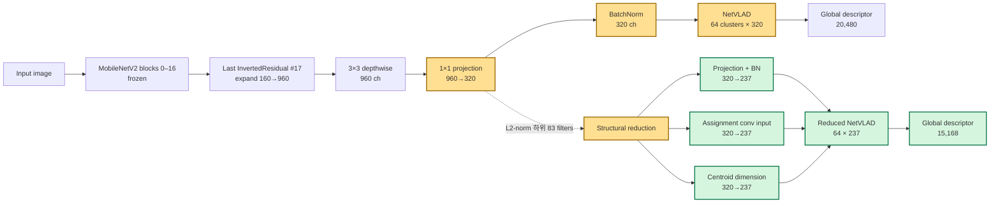

# ETRI Robot Compression Evaluation

Pittsburgh30k 장소 인식 모델의 pruning과 실제 구조 축소 효과를 평가하는
프로젝트입니다. 최근 수행한 **MobileNetV2 + NetVLAD 관계 KD / KD-off 대조실험**은
2026-09-08 사용자 요청으로 두 학습과 소속 worker를 모두 종료했습니다.

## 최근 결과: 15% pruning, 관계 KD 대조실험

완료된 epoch 중 validation R@1 최고점을 기준으로 정리한 결과입니다.

| 조건 | 완료 epoch | 선택 epoch | Val R@1 | Val R@5 | Val R@10 | Val R@20 |
|---|---:|---:|---:|---:|---:|---:|
| KD-on (0.5) | 63 | 37 | **82.0978%** | 93.7040% | 96.0962% | 97.8049% |
| KD-off (0) | 19 | 3 | **79.0089%** | 92.1924% | 94.9527% | 96.9111% |

R@1 차이는 **+3.0889%p**이며, 첫 19 epoch만 비교해도 +3.0757%p입니다.
이는 zero-pruned 모델의 validation 결과입니다. 두 student의 test 및 실제 구조
축소 후 Recall은 아직 측정하지 않았습니다. KD-off에서는 triplet loss 계수도
0.5에서 1로 바뀌므로, KD 항만의 독립적인 효과로 단정하지 않습니다.

구현·수식·checkpoint·모든 epoch 결과와 한계는
[상세 최종 보고서](docs/KD_ABLATION_FINAL_20260908.md),
수치 원본을 합친 표는 [전체 epoch CSV](docs/assets/kd_ablation_20260908_metrics.csv)에 있습니다.

MobileNetV3-Large의 trainable parameter 압축률 72%·76%·80% 비교는
[기존 V3-Large 실험 계획](docs/FINAL_V3_LARGE_EXPERIMENT_PLAN.md)으로 보존하며 현재 보류 상태입니다.

## 이전 결과: 26% pruning, 구조 축소 완료

- MobileNetV2 마지막 projection: 320 → 237채널
- 실제 제거량: 83/320채널, 25.9375%
- NetVLAD descriptor: 20,480 → 15,168차원
- 학습 가능 파라미터: 514,880 → 424,410
- ResNet18 기준 trainable parameter 압축률: **80.0978%**
- ResNet18 기준 total parameter 압축률: 37.4118%

| Reduced 모델 | 선택 Epoch | Test R@1 | R@5 | R@10 | R@20 |
|---|---:|---:|---:|---:|---:|
| R@1 우선 | 4 | **0.6920** | 0.8392 | 0.8906 | 0.9250 |
| R@5 우선 | 2 | 0.6891 | **0.8417** | 0.8879 | 0.9222 |
| 마지막 모델 | 30 | 0.6401 | 0.8201 | 0.8693 | 0.9089 |

validation 최고점은 R@5가 epoch 2, R@1이 epoch 4였습니다. 학습 loss가
줄어도 후반 Recall은 하락했으므로 배포에는 epoch 30이 아닌
validation-selected checkpoint를 사용합니다.

상세 구현, 전체 30 epoch 지표, 축소 전후 결과와 계산식은
[구현 및 실험 결과](docs/implmentation.md)에 정리했습니다.

## Pruning 아키텍처



마지막 projection은 residual shortcut이 없는 160→320 출력 블록이어서 앞쪽
branch를 수정하지 않고 channel을 줄일 수 있습니다. 선택된 projection과
BatchNorm만 0으로 만드는 데서 끝나지 않고, 구조 축소 시 그 channel을 입력으로
사용하는 NetVLAD assignment convolution과 centroid도 같은 index로 줄입니다.
NetVLAD cluster 수 64는 유지합니다.

## 빠른 시작

### 1. 독립 환경

```bash
./scripts/bootstrap_env.sh
source .venv/bin/activate
```

Python 3.10, PyTorch 2.7.1 + CUDA 12.8 환경을 프로젝트의 <code>.venv</code>에
구성합니다. 시스템 Python에는 패키지를 설치하지 않습니다.

### 2. 자원과 데이터 확인

```bash
./scripts/check_resources.sh
source .env
./scripts/download_pittsburgh.sh
robot-compression check
```

기본 데이터 경로는 <code>data/datasets/pittsburgh</code>입니다. 공용 서버의
기본 물리 GPU는 2번이며 <code>CUDA_VISIBLE_DEVICES=2</code> 때문에
프로그램에서는 <code>cuda:0</code>으로 보입니다. 다른 사용자의 프로세스는
종료하지 않습니다.

### 3. Centroid 생성

NetVLAD centroid는 backbone별로 먼저 생성해야 합니다.

```bash
robot-compression cluster --arch mobilenetv2 --num-clusters 64
```

구버전 실험을 재현하기 위해 MobileNetV2는 torchvision
<code>IMAGENET1K_V1</code>을 명시적으로 사용합니다.

### 4. 26% pruning 학습

아래 명령은 이번 실험과 동일하게 물리 GPU 0을 사용합니다.

```bash
CUDA_VISIBLE_DEVICES=0 robot-compression train \
  --arch mobilenetv2 \
  --num-clusters 64 \
  --epochs 30 \
  --batch-size 1 \
  --cache-batch-size 48 \
  --workers 8 \
  --kd-weight 0 \
  --pruning \
  --pruning-ratio 0.26
```

학습 run에는 <code>metrics.csv</code>, R@5 기준 <code>best.pt</code>, R@1 기준
<code>best_r1.pt</code>, 재개용 <code>latest.pt</code>, 실행 환경을 담은
<code>run_metadata.json</code>이 저장됩니다.

### 5. 실제 구조 축소와 평가

```bash
robot-compression reduce \
  --checkpoint artifacts/runs/<run>/checkpoints/best_r1.pt \
  --output artifacts/runs/<run>/checkpoints/best_r1_reduced.pt \
  --pruning-ratio 0.26

robot-compression test \
  --checkpoint artifacts/runs/<run>/checkpoints/best_r1_reduced.pt \
  --split test \
  --cache-batch-size 48 \
  --workers 8
```

Reduced checkpoint는 구조가 달라 학습을 재개할 수 없으므로 optimizer와
scheduler 상태를 포함하지 않습니다. 이번 reduced 파일은 약 7.28 MB입니다.

## 프로젝트 구조

```text
src/robot_compression/
├── compression/    # channel pruning과 structural reduction
├── data/           # Pittsburgh loader와 hard-negative mining
├── models/         # CNN encoder와 NetVLAD
├── training/       # clustering, 학습, Recall 평가
├── cli.py          # check/cluster/train/test/reduce
└── config.py       # 환경과 경로

scripts/            # 환경·데이터·자원 점검
tests/              # CPU 단위/smoke 테스트
docs/               # 구현과 실험 문서
artifacts/          # checkpoint/centroid/log, Git 제외
data/               # 데이터셋, Git 제외
trash/legacy/       # 옮겨온 구버전 코드
```

## KD 주의사항

구버전 KD 코드는 student logits까지 <code>no_grad</code>에서 계산했고 서로 다른
NetVLAD centroid의 cluster 번호도 직접 비교했습니다. 최종 실험은 이 방식을
사용하지 않습니다. query와 positive/hard negatives 사이의 cosine 검색 분포를
KL divergence로 맞추는 차원 독립적인 관계 KD를 사용합니다. 현재 학습 코드의 loss는
<code>(1 − λ) × triplet + λ × KD</code>이며, 이번 KD-on은 λ=0.5,
KD-off는 λ=0입니다. 기존 V3 계획 문서의 additive loss는 이번 V2 실행식과
구분해야 합니다. feature projection KD는 이번 대조실험에 사용하지 않았습니다.

## 문서

- [관계 KD / KD-off 상세 최종 보고서 (2026-09-08)](docs/KD_ABLATION_FINAL_20260908.md)
- [KD-off 대조실험 실행·종료 기록](docs/KD_OFF_CONTROL_20260908.md)
- [PPT 2장 구성안](docs/PPT_2SLIDE_CONTENT.md)
- [상세 구현 및 최종 실험 결과](docs/implmentation.md)
- [전체 실험 진행 기록](docs/EXPERIMENT_SUMMARY.md)
- [15% GPU 0 재현](docs/REPRODUCTION_GPU0_20260831.md)
- [아키텍처와 구버전 대응](docs/ARCHITECTURE.md)
- [Pittsburgh 데이터셋](docs/DATASET.md)
- [구버전 실험 감사 — ResNet test 이상치와 MobileNetV3 현황](docs/LEGACY_AUDIT_20260907.md)
