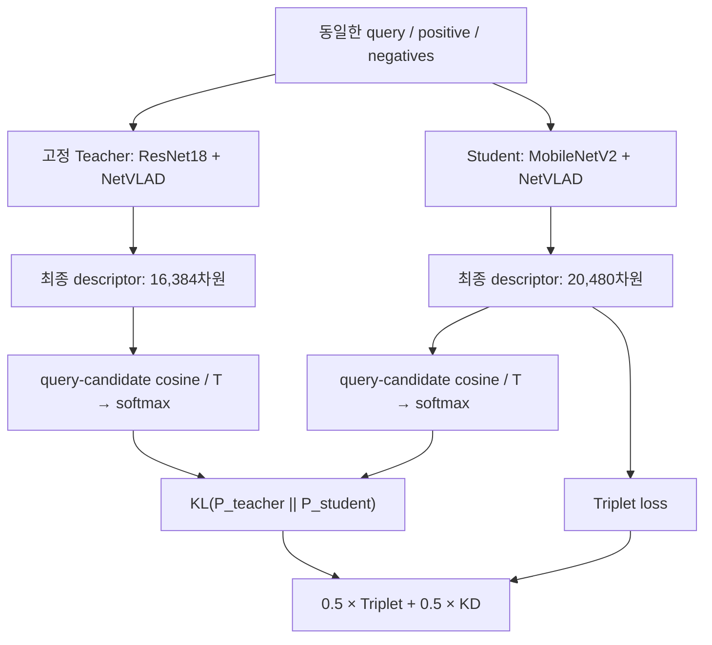

# MobileNetV2 + NetVLAD 관계 KD 구현 및 KD-off 대조실험 최종 기록

작성일: 2026-09-08 · 시간대: Asia/Seoul · 상태: 두 학습 수동 종료 완료

## 1. 결과 요약과 보고 범위

MobileNetV2 + NetVLAD 64 clusters에 마지막 projection 출력 채널 15% pruning을 적용하고,
관계 KD 사용 여부를 비교했다. 사용자 요청으로 2026-09-08 21:40:26에 두 학습에
SIGINT를 전달했으며 21:40:31 이후 학습 부모와 소속 worker의 종료를 확인했다.
KD-on은 63 epoch, KD-off는 19 epoch까지 학습·validation·체크포인트 저장을 완료했다.
진행 중이던 epoch 64와 epoch 20의 미저장 계산은 결과에 포함하지 않는다.

이번 보고서의 주 선택 기준은 **완료된 epoch 중 validation R@1 최고점**이다.
이는 사용자 요청에 따른 최종 정리 기준이며, 기존 코드의 R@5 자동 조기 종료가
발동한 결과는 아니다. R@5 최고 checkpoint도 보조 결과로 보존했다.

| R@1 기준 선택 모델 | Epoch | Val R@1 (%) | Val R@5 (%) | Val R@10 (%) | Val R@20 (%) |
|---|---:|---:|---:|---:|---:|
| KD-on (`best_r1.pt`) | 37 | 82.0978 | 93.7040 | 96.0962 | 97.8049 |
| KD-off (`best_r1.pt`) | 3 | 79.0089 | 92.1924 | 94.9527 | 96.9111 |
| KD-on − KD-off (%p) | — | 3.0889 | 1.5116 | 1.1435 | 0.8938 |

Validation query 7,608개 중 R@1 성공 수는 KD-on 6,246개, KD-off 6,011개로 235개 차이다.
이 값은 성공 개수의 차이이며 어떤 query에서 서로 정답이 달랐는지는 저장된 Recall만으로 알 수 없다.

**이 표는 zero-pruned 모델의 validation 결과다.** 두 student의 test split 성능,
실제 구조 축소 후 validation/test 성능, latency, FLOPs, 에너지 사용량은 이번 두 run에서
측정하지 않았다. 따라서 test 일반화 성능이나 실제 배포 속도 개선으로 해석하지 않는다.

주요 근거는 각 run의 `metrics.csv`, `config.json`, `run_metadata.json` 및
`checkpoints/{best_r1,best,latest}.pt`이다. 종료 후 CPU에서 checkpoint를 다시 로드해
기록된 epoch/Recall과 CSV의 일치를 검사했다.

## 2. 실험 식별자와 종료 상태

| 항목 | KD-on | KD-off |
|---|---|---|
| Run | `20260907_181321_mobilenetv2_netvlad_prune0p15_kdrel0p5` | `20260908_112757_mobilenetv2_netvlad_prune0p15` |
| 시작 시각 | 2026-09-07 18:13 KST | 2026-09-08 11:27 KST |
| 종료 전 PID / process group | 1706268 | 2583716 |
| 마지막 완료 epoch | 63 | 19 |
| 종료 시 미완료 epoch | 64 | 20 |
| 마지막 checkpoint 저장 | 2026-09-08 21:27:39 KST | 2026-09-08 21:06:19 KST |
| 종료 방식 | SIGINT에 의한 사용자 요청 수동 종료 | SIGINT에 의한 사용자 요청 수동 종료 |
| 물리 GPU | 2 | 2 |

종료 전 각 process group의 cwd와 실행 인자를 확인했다. 그룹당 부모 1개와 worker 16개,
총 34개 프로세스가 두 학습에 속했다. 두 부모에 SIGINT를 보낸 뒤 5초 후 남은 실행
프로세스가 없어 SIGTERM/SIGKILL은 추가로 사용하지 않았다. 부모 PID도 `/proc`에서
사라졌으며 프로젝트 CLI 학습·평가 작업이 남아 있지 않음을 확인했다.

학습 외의 Jupyter/터미널/Codex 세션과 다른 프로젝트·사용자의 GPU 작업은 종료하지 않았다.
GPU 2의 메모리 사용량은 두 학습 종료 후 약 18,489 MiB에서 9,407 MiB로 감소했다.
남은 GPU 사용량을 본 프로젝트 학습이 남아 있다는 증거로 해석하면 안 된다.
원본 데이터, 체크포인트, TensorBoard event, 로그와 중단 시 남은 cache는 삭제하지 않았다.

## 3. 데이터와 모델

### 3.1 Pittsburgh30k

| Split | Database 이미지 | Query 이미지 | 용도 |
|---|---:|---:|---|
| Train | 10,000 | 7,416 | Triplet 학습 및 teacher/student descriptor cache |
| Validation | 10,000 | 7,608 | 매 epoch Recall 계산 및 checkpoint 선택 |
| Test | 10,000 | 6,816 | 별도 최종 평가용; 이번 두 student에서는 미평가 |

로컬 경로는 `data/datasets/pittsburgh`이며 `.mat` split 명세를 직접 확인했다.
학습 가능한 query는 10 m 이내 nontrivial positive가 있는 7,320개다.
이미지는 RGB로 읽고 `ToTensor` 및 ImageNet mean/std 정규화를 적용한다.
현재 loader에는 random crop, flip, resize augmentation이 없다.

Positive 후보는 10 m 이내 이미지이며 현재 student descriptor 기준으로 가장 가까운
positive를 선택한다. Negative는 query에서 25 m 이내의 이미지를 제외한 pool에서
최대 1,000개를 표본화하고, margin을 위반하는 hard negative를 최대 10개 선택한다.
Negative가 하나도 margin을 위반하지 않는 query 묶음은 해당 step에서 건너뛴다.

7,320개 query를 8개 subset(각 915개)으로 나누며, subset마다 train 전체 17,416장의
student descriptor cache를 새로 생성한다. 두 run의 cache 파일명에는 run 이름이 포함돼
동시 실행 시 서로 덮어쓰지 않는다. DataLoader shuffle과 hard-negative sampling은
seed의 영향을 받으며, 모델이 달라지면 실제로 채굴되는 후보도 달라질 수 있다.

### 3.2 Teacher와 student

| 항목 | Teacher | Student (KD-on/off 공통) |
|---|---|---|
| Encoder | ResNet18, layer3까지 | MobileNetV2, features 0–17 |
| Encoder 출력 채널 | 256 | 320 |
| NetVLAD cluster 수 | 64 | 64 |
| 최종 descriptor 차원 | 16,384 | 20,480 |
| Student 초기 가중치 | — | torchvision ImageNet1K V1 |
| 학습 중 업데이트 | 없음, 고정 teacher | 마지막 InvertedResidual #17과 NetVLAD |

Student는 마지막 `320→1280` convolution과 classifier를 제외한다.
앞쪽 features 0–16은 parameter를 동결하고 학습 중에도 eval mode로 유지해
BatchNorm running statistics가 변하지 않도록 한다. 마지막 블록과 NetVLAD는 학습한다.

Teacher는 ResNet18 seed 123, epoch 4의 validation R@5 best를 사용한다.
Seed 42의 Val R@5 91.1409%와 seed 123의 91.2461%를 비교해 선택했으며
test 성능을 teacher 선택에 사용하지 않았다는 기존 실행 기록을 따른다.
Teacher의 Val R@1은 78.9958%다. 별도로 저장된 teacher test R@1 80.6925%는
teacher의 참고 결과이며 이번 student validation 표와 직접 비교하지 않는다.

### 3.3 NetVLAD 계산

각 위치의 local feature `x_l`을 채널 방향으로 L2 정규화하고, 1×1 assignment convolution으로
`K=64`개 cluster logit을 만든다. Cluster 방향 softmax 값 `a_kl`로 residual을 가중합한다.

```text
a_kl = softmax_k(W x_l)
v_k  = sum_l a_kl * (x_l - c_k)
z    = L2_normalize(concat_k(L2_normalize(v_k)))
```

`c_k`는 학습 가능한 centroid다. Student는 공통 centroid 파일
`mobilenetv2_imagenet1k_v1_pitts30k_64_desc_cen.hdf5`에서 초기화한다.
Centroid 생성 코드는 local descriptor 50,000개, 이미지당 100개, Faiss K-means
64 clusters / 100 iterations 설정이다. 두 대조 run에서 centroid를 새로 생성하지 않았다.

## 4. 관계 KD의 정확한 적용 위치

KD는 NetVLAD 내부 cluster logit에 붙지 않고 **최종 global descriptor로 계산한
query–candidate 유사도 분포**에 붙는다. Teacher와 student가 비교하는 후보 이미지
목록과 순서를 같게 유지하는 것이 핵심이다.



Query `q`와 후보 집합 `C=[p,n1,...,nk]`에 대해 다음을 계산한다.

```text
s_M(i) = cosine(z_M(q), z_M(C[i])) / T        # M = teacher 또는 student
P_M(i) = exp(s_M(i)) / sum_j exp(s_M(j))
L_KD(q) = sum_i P_teacher(i) * log(P_teacher(i) / P_student(i))
L_KD = query 묶음별 L_KD(q)의 평균
T = 0.1
```

현재 구현은 이 식에 `T²`를 추가로 곱하지 않는다. 후보가 positive 1장과 negative
10장이면 두 모델 모두 길이 11의 확률분포를 만든다. 원본 descriptor 차원이 달라도
각 항목은 동일한 후보 이미지를 가리키므로 projection head나 cluster index 정렬이 필요 없다.

Teacher가 어떤 positive/negative를 상대적으로 더 비슷하다고 보는지와 그 확률 차이를
student가 학습한다. 단순한 정렬 순서만 일치시키는 loss는 아니다. 한 query의 후보
집합에 대한 분포를 비교하며, 전체 batch의 모든 pair/모든 triple을 비교하지 않는다.

Teacher descriptor는 checkpoint SHA-256 기반 파일
`artifacts/cache/teacher_bbab64a55eede03c_pitts30k_train.hdf5`에 캐시되어 있다.
검증한 shape는 `(17416, 16384)`, dtype은 float32다. Teacher는 고정하고
캐시 또는 `no_grad`에서 얻은 출력을 사용하며 loss 내부에서도 detach한다.
Student embedding은 gradient graph에 남긴다.

Gradient 경로는 `KD → student cosine/softmax → student descriptor → NetVLAD →
마지막 MobileNetV2 블록`이다. NetVLAD assignment convolution과 centroid도
이 경로를 통해 간접적으로 업데이트된다. 동결된 앞쪽 블록과 teacher는 업데이트하지 않는다.

### 4.1 Legacy와의 차이

| 항목 | Legacy의 의도 | 이번 구현 |
|---|---|---|
| 비교 위치 | NetVLAD cluster assignment logits | Global descriptor에서 계산한 검색 유사도 분포 |
| 대응 축 | Teacher cluster k ↔ student cluster k | 동일 query와 동일 후보 이미지의 쌍 |
| 차원 맞춤 | 양쪽 cluster 수 K를 맞춤 | 양쪽 후보 이미지 목록과 순서를 맞춤 |
| 핵심 한계/처리 | 독립 centroid의 cluster 번호 의미가 불일치할 수 있음 | 이미지 identity로 대응하므로 cluster 번호 정렬 불필요 |
| Student KD gradient | 구버전 감사에서 no_grad로 차단된 오류 확인 | Student gradient가 유지됨을 테스트 |

현재 코드에도 과거 soft-assignment용 `distillation_loss` 함수가 남아 있지만
이번 `train_one_epoch`는 `relational_distillation_loss`를 호출한다.

### 4.2 논문과의 관계

- [Park et al., Relational Knowledge Distillation, CVPR 2019](https://arxiv.org/pdf/1904.05068):
  샘플 관계를 증류한다는 관점을 공유한다. 논문의 구체적인 RKD-D/RKD-A는
  정규화한 pairwise distance와 triple angle에 Huber loss를 사용하므로 이번 구현과 다르다.
- [Passalis & Tefas, Learning Deep Representations with Probabilistic Knowledge Transfer, ECCV 2018](https://arxiv.org/pdf/1803.10837):
  관계를 조건부 확률로 표현하고 teacher/student 분포의 KL을 줄인다는 점이 가깝다.
  논문은 주로 `(cosine+1)/2` kernel의 정규화를 사용하며 이번 구현은 temperature softmax를 사용한다.
- [Roth et al., Simultaneous Similarity-based Self-Distillation for Deep Metric Learning, ICML 2021](https://proceedings.mlr.press/v139/roth21a/roth21a.pdf):
  §3.2의 cosine similarity → temperature softmax → KL 구성 요소가 특히 가깝다.
  다만 공유 백본의 보조 embedding branch와 batch 관계를 사용하는 논문의 전체
  self-distillation 절차를 이 프로젝트가 재현한 것은 아니다.

논문과 코드를 대조한 분류이며, 특정 논문에서 코드를 직접 가져왔다는 provenance는 확인되지 않았다.
이번 방법은 **query–candidate cosine similarity distribution의 KL 기반 KD**로 기술한다.

## 5. Triplet loss, KD weight와 대조실험

```text
L_triplet = 평균_(query, negative) max(||z_q-z_p||₂ - ||z_q-z_n||₂ + sqrt(0.1), 0)
L_total   = (1-lambda) * L_triplet + lambda * L_KD
KD-on:  lambda = 0.5 → 0.5 * L_triplet + 0.5 * L_KD
KD-off: lambda = 0   → L_triplet
```

실제 코드는 각 query-negative triplet을 합산한 뒤 해당 묶음의 negative 개수로
나눈다. 이번 batch size가 1이므로 위 식과 대응한다. Epoch loss는 유효한 batch들의
평균이며 validation Recall과 평가 단위가 다르다.

두 `config.json`을 비교한 결과 변경된 항목은 `kd_weight` 하나뿐이다.
Teacher checkpoint 인자도 유지해 모델 생성에 따른 초기 난수 소비 순서를 맞추었다.
KD-off에서는 teacher 모델이 생성되어도 descriptor 추론이나 KD loss는 계산하지 않는다.

중요한 비교 한계: KD-off에서 **triplet 계수도 0.5에서 1로 바뀐다**.
따라서 이번 결과는 기존 CLI의 KD weight 0/0.5 설정 비교이며, triplet 계수를
고정한 상태에서 KD 항만 제거한 엄밀한 ablation은 아니다. Learning rate를 같게
두었어도 triplet gradient의 계수는 다르다. 향후 KD 항만의 인과적 기여를 더
분리하려면 triplet 계수를 고정한 대조군이 필요하다. 이번에는 추가 실험을 실행하지 않았다.

## 6. Pruning과 구조 축소

### 6.1 이번 학습에서 실제 수행한 zero pruning

MobileNetV2 마지막 블록은 `160→960 expansion → depthwise → 960→320 projection`
구조다. 마지막 projection의 output filter마다 L2 norm을 구하고 작은 순서대로
`int(320 * 0.15)=48`개를 선택한다.

매 optimizer step 직후 선택된 projection filter와 대응 BatchNorm weight/bias를 0으로
설정하고, 해당 running mean을 0, running variance를 1로 설정한다.
선택은 매 step의 norm으로 다시 계산한다. 고정 mask가 gradient를 차단하는 구현은 아니며
NetVLAD의 해당 입력 slice/centroid slice를 학습 중 매번 같이 0으로 만들지는 않는다.
두 R@1 최고 checkpoint에서 zero projection channel이 정확히 48개임을 확인했다.

### 6.2 구조 축소 코드와 파라미터

구조 축소는 남은 272개 채널 index로 projection 출력, BatchNorm,
NetVLAD assignment convolution 입력, centroid feature 차원을 함께 줄인다.
Cluster 수 64는 유지하며 descriptor는 20,480에서 17,408차원으로 바뀐다.

| 모델 상태 | Total params | Trainable params | Descriptor 차원 | ResNet18 대비 trainable 감소율 |
|---|---:|---:|---:|---:|
| ResNet18 기준 | 2,815,552 | 2,132,480 | 16,384 | 0% |
| 이번 두 checkpoint: zero-pruned | 1,852,672 | 514,880 | 20,480 | 75.8553% |
| 두 checkpoint의 메모리 내 구조 축소 검증 | 1,800,352 | 462,560 | 17,408 | 78.3088% |

감소율은 `100 × (1 - student parameter 수 / ResNet18 parameter 수)`로 계산했다.
메모리 내 구조 축소 모델의 total parameter 감소율은 ResNet18 대비 36.0569%다.
15%는 마지막 projection 채널 제거 비율이며, 전체 모델 parameter 15% 제거라는 뜻이 아니다.
이 15% 설정은 과제의 trainable parameter 80% 감소 목표에는 도달하지 않는다.

메모리 내 구조 축소와 합성 입력 forward는 이번 정리 과정에서 CPU로 검증했지만,
두 run에 배포용 reduced checkpoint를 새로 저장하거나 검색 성능을 재평가하지 않았다.
Zero feature channel도 NetVLAD에서는 centroid와의 residual에 영향을 줄 수 있으므로
구조 축소 전 Recall을 그대로 축소 모델의 Recall로 인용할 수 없다.

R@1 최고 training checkpoint 크기는 두 모델 모두 **9,706,241 bytes**다.
Optimizer/scheduler와 metadata가 포함된 파일이며 순수 배포 가중치 크기가 아니다.
Reduced 직렬화 파일 크기는 이번 두 모델에서 측정하지 않았다.

## 7. 공통 학습 설정

| 설정 | 값 |
|---|---|
| Seed | 42 |
| Maximum epochs | 100 (완료 전 사용자 요청으로 수동 종료) |
| Batch size | 1 query group |
| Cache batch size / workers | 48 / 8 |
| Optimizer | SGD |
| Initial learning rate | 1e-4 |
| Momentum / weight decay | 0.9 / 1e-3 |
| Scheduler | StepLR(step_size=5, gamma=0.5), epoch 종료 시 step |
| Triplet margin | sqrt(0.1) |
| Pruning | 명시 활성화, ratio 0.15 |
| KD lambda | 0.5 / 0 |
| KD temperature | 0.1 |
| 기존 자동 종료 | R@5 미개선 횟수가 patience=30을 초과하면 종료 |
| 이번 최종 선택 | Validation R@1 최고 checkpoint |
| Runtime | Python 3.10 계열 .venv, PyTorch 2.7.1+cu128 |
| 물리 GPU | RTX A5000 GPU 2 |

동일한 seed/설정으로 시작했지만, GPU 연산 결정성 강제나 모든 초기 tensor의
동일성을 기록한 별도 검증은 없다. 두 run의 학습 상태가 달라지면 hard negative 선택도
달라진다. 또한 병렬 GPU 점유 상황이 달라 경과 시간으로 학습 효율을 비교하지 않는다.

## 8. 최고점, 마지막 모델과 학습 추이

### 8.1 R@5 최고 checkpoint는 별도 보존

| R@5 기준 선택 모델 | Epoch | Val R@1 (%) | Val R@5 (%) | Val R@10 (%) | Val R@20 (%) |
|---|---:|---:|---:|---:|---:|
| KD-on (`best.pt`) | 46 | 82.0321 | 93.8486 | 96.1882 | 97.8049 |
| KD-off (`best.pt`) | 3 | 79.0089 | 92.1924 | 94.9527 | 96.9111 |

KD-on의 R@1 best(epoch 37)와 R@5 best(epoch 46)는 다른 모델이다.
각 rank의 최고값을 여러 epoch에서 모아 하나의 모델 성능처럼 보고하지 않는다.

### 8.2 마지막 저장 모델

| 마지막 모델 | Epoch | Val R@1 (%) | Val R@5 (%) | Val R@10 (%) | Val R@20 (%) |
|---|---:|---:|---:|---:|---:|
| KD-on (`latest.pt`) | 63 | 81.5457 | 93.5331 | 95.5310 | 97.6735 |
| KD-off (`latest.pt`) | 19 | 76.8270 | 90.2603 | 93.9537 | 96.4380 |

KD-on은 R@1 최고점 이후 26 epoch, KD-off는 16 epoch 동안 최고점을 갱신하지 못했다.
최근 10 epoch의 R@1 범위는 각각 80.2839–81.5457%, 76.8270–77.8917%다.
최근 10개에서 최고점 갱신은 양쪽 모두 0회다. 수치 변동은 남아 있으므로
모든 파라미터가 수렴했다고 단정하지 않고, validation 최고점 개선 정체로 해석한다.
특히 KD-on의 마지막 learning rate는 2.44140625e-8이다. 학습 가능한 마지막 블록의
BatchNorm statistics와 후보 채굴도 변하므로 낮은 learning rate가 일정한 Recall을 보장하지 않는다.

### 8.3 동일한 관측 구간: 첫 19 epoch

| 관측 범위 | KD-on 최고 Val R@1 | KD-off 최고 Val R@1 | 차이 |
|---|---:|---:|---:|
| 각각 첫 19 epoch | 82.0846%, epoch 18 | 79.0089%, epoch 3 | +3.0757%p |

전체 관측 기간이 63/19 epoch로 달라 KD-on에 더 많은 checkpoint 선택 기회가 있었다.
첫 19 epoch만 비교해도 차이가 남는다는 것은 참고 근거다. 다만 epoch 18의 KD-on
가중치는 현재 보존된 best/latest 파일에 없으므로 이 비교는 **metrics.csv 기반**이며
해당 모델의 추가 test 평가를 수행할 수 있는 checkpoint 보존을 의미하지 않는다.

### 8.4 선택 시점의 학습 loss

| 조건 / 선택 epoch | Total loss | Triplet loss | KD loss |
|---|---:|---:|---:|
| KD-on / 37 | 0.116553 | 0.178571 | 0.054534 |
| KD-off / 3 | 0.195151 | 0.195151 | 0.000000 |

Total loss는 두 조건의 계수가 달라 그대로 비교하면 안 된다. KD-off는 epoch 3의
triplet loss 0.195151에서 epoch 19의 0.113160으로 낮아졌지만 R@1은 79.0089%에서
76.8270%로 하락했다. 낮아지는 training loss가 높은 validation Recall을 보장하지 않는 사례다.

## 9. 결과 해석과 한계

이번 관측에서는 관계 KD를 사용한 설정이 같은 15% zero pruning 설정의 KD-off보다
validation R@1이 3.0889%p 높았다. 동일한 최초 19 epoch 범위에서도 3.0757%p 차이가
관측되어, 차이를 단순히 추가 학습 기간만으로 설명하기는 어렵다.

다만 아래 이유로 이를 KD 항만의 독립적인 인과 효과나 통계적으로 유의한 개선으로
확정하지 않는다.

1. Lambda 변경으로 triplet 계수도 달라졌다.
2. 두 조건 모두 seed 42 한 번씩이며 seed 간 분산과 신뢰구간을 측정하지 않았다.
3. 최종 학습 기간과 checkpoint 선택 기회가 달랐다.
4. 사용자 요청에 따라 학습 중 R@1 추이를 본 후 수동 종료했고 주 선택 기준을 R@1로 정했다.
   사전에 등록한 R@1 조기 종료 정책을 그대로 실행한 실험이라고 기술하지 않는다.
5. Student test 및 구조 축소 후 Recall은 아직 없다. Teacher test 수치나 기존 26% 실험의
   test 값을 이번 15% 실험의 결과로 재사용하지 않는다.
6. Teacher 성능이 student 성능의 상한은 아니지만, validation에서 teacher를 넘은 결과만으로
   다른 장소/도시에 대한 일반화가 더 좋다고 결론낼 수 없다.

후속 검증 항목은 고정 triplet 계수 대조, 다중 seed, R@1-selected 모델의 test 평가,
구조 축소 후 Recall/직렬화 크기/latency 측정이다. 이 항목들은 **미실행**이며
이번 종료 요청 이후 추가 백그라운드 학습·평가를 예약하지 않았다.

## 10. 구현 파일과 검증

| 역할 | 파일 |
|---|---|
| CLI, seed, optimizer/scheduler, checkpoint/metrics | [cli.py](../src/robot_compression/cli.py) |
| Backbone 구성, 동결 범위 | [models/factory.py](../src/robot_compression/models/factory.py) |
| Assignment, residual aggregation, L2 normalization | [models/netvlad.py](../src/robot_compression/models/netvlad.py) |
| Dataset, 거리 기반 후보, hard-negative mining | [data/pittsburgh.py](../src/robot_compression/data/pittsburgh.py) |
| Feature cache, triplet, 관계 KD, Recall | [training/engine.py](../src/robot_compression/training/engine.py) |
| Zero pruning 및 structural reduction | [compression/mobilenet.py](../src/robot_compression/compression/mobilenet.py) |
| 기존 단위/CPU smoke 검증 | [tests/test_smoke.py](../tests/test_smoke.py) |

이번 정리 작업에서는 학습 코드를 변경하지 않았다. KD-off 시작 전 검증은
`pytest` 11 passed(3 SWIG deprecation warnings), CLI `check` 통과, CPU smoke 통과였다.
종료 후 추가 검사에서 두 run의 각 3개 checkpoint 모두 CPU model/optimizer/scheduler
로드가 성공했고, 모든 저장 Recall이 해당 CSV epoch와 일치했다.

두 R@1 최고 모델은 합성 CPU 입력 `(1,3,64,64)`에서 정상/메모리 내 축소 출력이
각각 `(1,20480)`, `(1,17408)`이며 모두 finite였다. 이 검사는 구조와 로드 가능성
확인이며 실제 dataset 성능 평가가 아니다. Epoch CSV는 KD-on 1–63, KD-off 1–19가
누락/중복 없이 연속임을 확인했다.

최종 문서 검증에서 총 82개 epoch의 loss 식과 최고점 선택, 체크포인트 6개의
SHA-256 보존, 로컬 문서 링크 37개, cli/engine 소스 hash 유지 및
`git diff --check` 통과를 확인했다. 2026-09-08 21:49:10 KST에 다시 점검한
프로젝트 학습·평가 프로세스와 기존 두 process group의 잔여 프로세스 수는 0이었다.

## 11. 산출물, 재현 명령과 보존

- [전체 epoch CSV](assets/kd_ablation_20260908_metrics.csv): 두 run의 loss, Recall, learning rate를 합친 파생 표.
- [기계 판독용 상세 검증 결과](../artifacts/results/kd_ablation_20260908_summary.json):
  config, 전체 epoch, checkpoint hash/크기/parameter, 종료 및 평가 범위.
- [KD-off 시작 기록](KD_OFF_CONTROL_20260908.md).
- KD-on: [R@1 최고 checkpoint](../artifacts/runs/20260907_181321_mobilenetv2_netvlad_prune0p15_kdrel0p5/checkpoints/best_r1.pt), [원본 metrics](../artifacts/runs/20260907_181321_mobilenetv2_netvlad_prune0p15_kdrel0p5/metrics.csv), [실행 metadata](../artifacts/runs/20260907_181321_mobilenetv2_netvlad_prune0p15_kdrel0p5/run_metadata.json).
- KD-off: [R@1 최고 checkpoint](../artifacts/runs/20260908_112757_mobilenetv2_netvlad_prune0p15/checkpoints/best_r1.pt), [원본 metrics](../artifacts/runs/20260908_112757_mobilenetv2_netvlad_prune0p15/metrics.csv), [실행 metadata](../artifacts/runs/20260908_112757_mobilenetv2_netvlad_prune0p15/run_metadata.json).

Checkpoint와 데이터는 `artifacts/`, `data/`의 원래 위치에 보존하고 Git에 추가하지 않는다.
기존 `best.pt`를 덮어쓰거나 R@1 모델로 이름을 바꾸지 않았다.
구버전 문서와 26% pruning 결과도 삭제하지 않고 역사적 실험 기록으로 유지한다.

다음은 기존 실행을 설명하는 재현 명령이며, 이번 문서 작성 중 재실행하지 않았다.
실행 전 `scripts/check_resources.sh`로 자원을 확인해야 한다.

```bash
CUDA_VISIBLE_DEVICES=2 TORCH_HOME=artifacts/torch .venv/bin/python -u -m robot_compression.cli train \
  --arch mobilenetv2 --teacher-arch resnet18 \
  --teacher-checkpoint artifacts/runs/20260907_145736_resnet18_netvlad/checkpoints/best.pt \
  --pooling netvlad --num-clusters 64 --batch-size 1 --cache-batch-size 48 --workers 8 \
  --epochs 100 --patience 30 --learning-rate 0.0001 --weight-decay 0.001 \
  --momentum 0.9 --margin 0.1 --seed 42 --kd-weight 0.5 --temperature 0.1 \
  --pruning --pruning-ratio 0.15
```

KD-off는 위 명령에서 `--kd-weight 0.5`만 `--kd-weight 0`으로 바꾼다.
실제 종료는 63/19 epoch에 수동으로 이루어졌으므로 이 명령만으로 종료 시점까지
자동 재현되지는 않는다. 재개 시 `--checkpoint latest.pt`가 지원되지만 RNG 상태는
저장되지 않아 끊김 없는 학습과 bitwise 동일한 경로를 보장하지 않는다.

Git commit은 `baf5a0ce78220af958591798757ace349669fa45`이며 기존 미커밋 코드 변경을
포함한 실행이다. 따라서 commit 단독으로 실행 코드를 특정할 수 없다.
KD-off 시작 기록에 남은 cli/engine SHA-256과 이번 종료 시점의 파일 hash를 함께 확인한다.

| 파일 | SHA-256 |
|---|---|
| KD-on best_r1.pt | `618e6d34fa4279991cb90289dce63b88ffa16e55a32c4490a16c7ce7c830a934` |
| KD-on best.pt | `c058ca365de46db6658cedd8ee8da2f0265e520bc2ca625eef9d992d0a7f167e` |
| KD-on latest.pt | `a49ddfcd9bbf26683c6d295d7763dfaf22174dbf4ffb91fc5ad80b649f1dbeea` |
| KD-off best_r1.pt | `205f191ce5f3743095fd599164e1cdc6be69abaef34764da97a55ba38ee54d1f` |
| KD-off best.pt | `113792ec6e3d96d157c81ed6d06c451c51c061cf77b28f24310d8ded67fffb86` |
| KD-off latest.pt | `5b96c0484983b4fdb9018fe9603cbbc47d464904cd2699ed93e836ddee6b3cc4` |

## 부록 A. 전체 epoch별 validation 및 loss

Recall은 %, learning rate는 학습에 사용된 해당 epoch 값이다. `R1*`는 그 시점의
R@1 최고점 갱신 여부다. 이 표는 전체 학습 곡선을 보존하며 최종 주 결과는 1절의
R@1-selected 모델 한 개씩이다.

### KD-on

| Epoch | R@1 | R@5 | R@10 | R@20 | Total loss | Triplet | KD | LR | R1* |
|---:|---:|---:|---:|---:|---:|---:|---:|---:|---:|
| 1 | 74.8160 | 90.0894 | 93.4017 | 96.0568 | 0.163179 | 0.231698 | 0.094660 | 1.0000e-4 | 1 |
| 2 | 77.9048 | 91.4826 | 94.7424 | 96.7534 | 0.145062 | 0.216261 | 0.073863 | 1.0000e-4 | 1 |
| 3 | 79.1009 | 92.2713 | 95.1236 | 97.1215 | 0.136562 | 0.206445 | 0.066678 | 1.0000e-4 | 1 |
| 4 | 79.3375 | 92.6393 | 95.3339 | 97.2003 | 0.131995 | 0.199549 | 0.064440 | 1.0000e-4 | 1 |
| 5 | 80.6125 | 92.6656 | 95.3470 | 97.3975 | 0.128582 | 0.195263 | 0.061901 | 1.0000e-4 | 1 |
| 6 | 81.1514 | 93.0599 | 95.6099 | 97.5158 | 0.126415 | 0.191717 | 0.061113 | 5.0000e-5 | 1 |
| 7 | 81.0594 | 93.3491 | 95.6230 | 97.4895 | 0.124918 | 0.189835 | 0.060000 | 5.0000e-5 | 0 |
| 8 | 79.4558 | 92.2976 | 94.9264 | 97.2266 | 0.123718 | 0.188592 | 0.058844 | 5.0000e-5 | 0 |
| 9 | 81.1120 | 93.2571 | 95.7413 | 97.6078 | 0.122708 | 0.186859 | 0.058558 | 5.0000e-5 | 0 |
| 10 | 81.1120 | 93.0336 | 95.5310 | 97.5421 | 0.122354 | 0.185925 | 0.058783 | 5.0000e-5 | 0 |
| 11 | 81.7429 | 93.3885 | 95.7939 | 97.6472 | 0.121429 | 0.185142 | 0.057716 | 2.5000e-5 | 1 |
| 12 | 81.4012 | 93.3228 | 95.6887 | 97.6735 | 0.120220 | 0.183220 | 0.057220 | 2.5000e-5 | 0 |
| 13 | 81.2171 | 92.7708 | 95.3470 | 97.5421 | 0.119853 | 0.183295 | 0.056411 | 2.5000e-5 | 0 |
| 14 | 81.5720 | 93.5857 | 95.6756 | 97.7392 | 0.119068 | 0.181666 | 0.056469 | 2.5000e-5 | 0 |
| 15 | 80.3102 | 92.9154 | 95.1630 | 97.3318 | 0.118527 | 0.181205 | 0.055848 | 2.5000e-5 | 0 |
| 16 | 79.5216 | 92.7182 | 95.1630 | 97.2792 | 0.118443 | 0.180836 | 0.056050 | 1.2500e-5 | 0 |
| 17 | 81.5457 | 93.5594 | 95.7545 | 97.6209 | 0.118498 | 0.180206 | 0.056789 | 1.2500e-5 | 0 |
| 18 | 82.0846 | 93.6909 | 95.9385 | 97.7918 | 0.117704 | 0.179467 | 0.055942 | 1.2500e-5 | 1 |
| 19 | 80.8885 | 93.0731 | 95.5705 | 97.4369 | 0.117981 | 0.180737 | 0.055225 | 1.2500e-5 | 0 |
| 20 | 81.6640 | 93.5726 | 95.7939 | 97.6998 | 0.117392 | 0.179787 | 0.054998 | 1.2500e-5 | 0 |
| 21 | 80.8097 | 93.1388 | 95.4522 | 97.5421 | 0.117598 | 0.180035 | 0.055160 | 6.2500e-6 | 0 |
| 22 | 81.7298 | 93.2571 | 95.8070 | 97.6866 | 0.117438 | 0.179457 | 0.055419 | 6.2500e-6 | 0 |
| 23 | 81.4669 | 93.0468 | 95.6625 | 97.5026 | 0.116854 | 0.179083 | 0.054625 | 6.2500e-6 | 0 |
| 24 | 81.1383 | 93.4280 | 95.6493 | 97.5815 | 0.117029 | 0.178880 | 0.055178 | 6.2500e-6 | 0 |
| 25 | 81.7298 | 93.4148 | 95.8333 | 97.6866 | 0.117043 | 0.178731 | 0.055355 | 6.2500e-6 | 0 |
| 26 | 81.3880 | 93.2702 | 95.6756 | 97.5421 | 0.117077 | 0.179576 | 0.054577 | 3.1250e-6 | 0 |
| 27 | 81.8612 | 93.6909 | 95.9385 | 97.7655 | 0.116712 | 0.178183 | 0.055240 | 3.1250e-6 | 0 |
| 28 | 81.1909 | 93.1914 | 95.4784 | 97.5683 | 0.116924 | 0.178832 | 0.055016 | 3.1250e-6 | 0 |
| 29 | 81.2960 | 93.2308 | 95.7282 | 97.6735 | 0.117195 | 0.179586 | 0.054803 | 3.1250e-6 | 0 |
| 30 | 81.1120 | 93.1782 | 95.6493 | 97.4895 | 0.116848 | 0.178850 | 0.054846 | 3.1250e-6 | 0 |
| 31 | 81.2697 | 93.3623 | 95.6756 | 97.6735 | 0.116837 | 0.178556 | 0.055117 | 1.5625e-6 | 0 |
| 32 | 79.9159 | 92.6525 | 95.1236 | 97.3712 | 0.116777 | 0.179221 | 0.054334 | 1.5625e-6 | 0 |
| 33 | 79.4427 | 92.1267 | 95.0053 | 97.2529 | 0.116539 | 0.178866 | 0.054213 | 1.5625e-6 | 0 |
| 34 | 81.9138 | 93.2308 | 95.7676 | 97.6998 | 0.115977 | 0.177826 | 0.054129 | 1.5625e-6 | 0 |
| 35 | 80.9280 | 93.0731 | 95.4127 | 97.3975 | 0.116554 | 0.178487 | 0.054621 | 1.5625e-6 | 0 |
| 36 | 81.5063 | 93.2965 | 95.5836 | 97.6341 | 0.116573 | 0.178388 | 0.054759 | 7.8125e-7 | 0 |
| 37 | 82.0978 | 93.7040 | 96.0962 | 97.8049 | 0.116553 | 0.178571 | 0.054534 | 7.8125e-7 | 1 |
| 38 | 80.1656 | 92.7182 | 95.2024 | 97.2792 | 0.116282 | 0.178485 | 0.054079 | 7.8125e-7 | 0 |
| 39 | 80.8097 | 92.9285 | 95.5967 | 97.3843 | 0.116356 | 0.178104 | 0.054609 | 7.8125e-7 | 0 |
| 40 | 80.4942 | 92.6788 | 95.1761 | 97.2923 | 0.116707 | 0.178661 | 0.054753 | 7.8125e-7 | 0 |
| 41 | 81.7560 | 93.4937 | 95.8728 | 97.6604 | 0.116283 | 0.178125 | 0.054442 | 3.9063e-7 | 0 |
| 42 | 80.5205 | 93.1388 | 95.3076 | 97.4632 | 0.116209 | 0.178392 | 0.054026 | 3.9063e-7 | 0 |
| 43 | 80.1788 | 92.5605 | 95.0315 | 97.3449 | 0.116005 | 0.177919 | 0.054091 | 3.9063e-7 | 0 |
| 44 | 79.6004 | 92.4159 | 95.0447 | 97.2529 | 0.116203 | 0.177961 | 0.054444 | 3.9063e-7 | 0 |
| 45 | 80.9411 | 92.9942 | 95.4784 | 97.3843 | 0.116628 | 0.179371 | 0.053884 | 3.9063e-7 | 0 |
| 46 | 82.0321 | 93.8486 | 96.1882 | 97.8049 | 0.117096 | 0.179399 | 0.054793 | 1.9531e-7 | 0 |
| 47 | 81.0726 | 93.3228 | 95.6887 | 97.5289 | 0.116726 | 0.178814 | 0.054639 | 1.9531e-7 | 0 |
| 48 | 81.5063 | 93.4411 | 95.5442 | 97.6472 | 0.116109 | 0.178265 | 0.053953 | 1.9531e-7 | 0 |
| 49 | 80.6519 | 93.0336 | 95.3601 | 97.5026 | 0.116650 | 0.178572 | 0.054728 | 1.9531e-7 | 0 |
| 50 | 81.3091 | 93.3360 | 95.7545 | 97.6735 | 0.116657 | 0.179110 | 0.054203 | 1.9531e-7 | 0 |
| 51 | 81.8875 | 93.3097 | 95.5967 | 97.7918 | 0.116596 | 0.178822 | 0.054369 | 9.7656e-8 | 0 |
| 52 | 81.8349 | 93.4674 | 96.1225 | 97.7918 | 0.116454 | 0.178489 | 0.054419 | 9.7656e-8 | 0 |
| 53 | 81.6903 | 93.2834 | 95.7939 | 97.7918 | 0.116981 | 0.179736 | 0.054226 | 9.7656e-8 | 0 |
| 54 | 81.4274 | 93.4280 | 95.4653 | 97.6078 | 0.116246 | 0.178116 | 0.054377 | 9.7656e-8 | 0 |
| 55 | 81.0594 | 93.2045 | 95.6099 | 97.4895 | 0.116445 | 0.178152 | 0.054737 | 9.7656e-8 | 0 |
| 56 | 81.3091 | 93.2834 | 95.5047 | 97.6341 | 0.116674 | 0.179095 | 0.054254 | 4.8828e-8 | 0 |
| 57 | 81.1251 | 93.0862 | 95.4390 | 97.3712 | 0.116474 | 0.178741 | 0.054207 | 4.8828e-8 | 0 |
| 58 | 81.2171 | 93.3097 | 95.7019 | 97.5026 | 0.116233 | 0.178565 | 0.053900 | 4.8828e-8 | 0 |
| 59 | 81.2566 | 93.1257 | 95.3076 | 97.5421 | 0.116080 | 0.177669 | 0.054491 | 4.8828e-8 | 0 |
| 60 | 81.5195 | 93.3623 | 95.6493 | 97.6735 | 0.116602 | 0.178673 | 0.054531 | 4.8828e-8 | 0 |
| 61 | 80.2839 | 92.6656 | 95.1498 | 97.3186 | 0.116470 | 0.178372 | 0.054568 | 2.4414e-8 | 0 |
| 62 | 81.5457 | 93.3754 | 95.6362 | 97.6866 | 0.116014 | 0.177766 | 0.054262 | 2.4414e-8 | 0 |
| 63 | 81.5457 | 93.5331 | 95.5310 | 97.6735 | 0.116474 | 0.178861 | 0.054087 | 2.4414e-8 | 0 |

### KD-off

| Epoch | R@1 | R@5 | R@10 | R@20 | Total loss | Triplet | KD | LR | R1* |
|---:|---:|---:|---:|---:|---:|---:|---:|---:|---:|
| 1 | 76.4984 | 90.6546 | 93.9406 | 96.4248 | 0.233995 | 0.233995 | 0.000000 | 1.0000e-4 | 1 |
| 2 | 78.7592 | 91.7192 | 94.7950 | 96.8191 | 0.213029 | 0.213029 | 0.000000 | 1.0000e-4 | 1 |
| 3 | 79.0089 | 92.1924 | 94.9527 | 96.9111 | 0.195151 | 0.195151 | 0.000000 | 1.0000e-4 | 1 |
| 4 | 78.3386 | 91.8375 | 94.8344 | 96.7534 | 0.180713 | 0.180713 | 0.000000 | 1.0000e-4 | 0 |
| 5 | 77.8523 | 91.1935 | 94.3743 | 96.4380 | 0.165693 | 0.165693 | 0.000000 | 1.0000e-4 | 0 |
| 6 | 78.3123 | 90.9306 | 94.3743 | 96.7271 | 0.155253 | 0.155253 | 0.000000 | 5.0000e-5 | 0 |
| 7 | 77.6814 | 90.7072 | 94.2166 | 96.4905 | 0.148657 | 0.148657 | 0.000000 | 5.0000e-5 | 0 |
| 8 | 77.5894 | 90.6414 | 94.0720 | 96.5168 | 0.143605 | 0.143605 | 0.000000 | 5.0000e-5 | 0 |
| 9 | 77.5368 | 90.6940 | 94.0063 | 96.4642 | 0.138698 | 0.138698 | 0.000000 | 5.0000e-5 | 0 |
| 10 | 76.9979 | 90.4048 | 93.7829 | 96.3328 | 0.131399 | 0.131399 | 0.000000 | 5.0000e-5 | 0 |
| 11 | 77.7734 | 90.7992 | 94.2298 | 96.4248 | 0.128056 | 0.128056 | 0.000000 | 2.5000e-5 | 0 |
| 12 | 77.8917 | 90.7729 | 94.2166 | 96.4905 | 0.124684 | 0.124684 | 0.000000 | 2.5000e-5 | 0 |
| 13 | 77.0110 | 90.5231 | 93.8749 | 96.3197 | 0.123723 | 0.123723 | 0.000000 | 2.5000e-5 | 0 |
| 14 | 77.3134 | 90.5494 | 93.9669 | 96.4117 | 0.119552 | 0.119552 | 0.000000 | 2.5000e-5 | 0 |
| 15 | 77.1293 | 90.5626 | 93.9800 | 96.3328 | 0.117569 | 0.117569 | 0.000000 | 2.5000e-5 | 0 |
| 16 | 77.1688 | 90.8517 | 94.1772 | 96.4511 | 0.116766 | 0.116766 | 0.000000 | 1.2500e-5 | 0 |
| 17 | 77.3791 | 90.7203 | 94.0063 | 96.4511 | 0.114797 | 0.114797 | 0.000000 | 1.2500e-5 | 0 |
| 18 | 77.5105 | 90.6940 | 94.0063 | 96.5563 | 0.111794 | 0.111794 | 0.000000 | 1.2500e-5 | 0 |
| 19 | 76.8270 | 90.2603 | 93.9537 | 96.4380 | 0.113160 | 0.113160 | 0.000000 | 1.2500e-5 | 0 |
