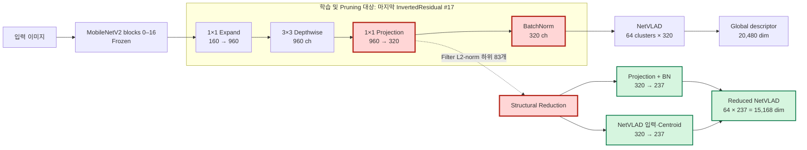

# PPT 2장 구성안: MobileNetV2 + NetVLAD Pruning

## 슬라이드 1. MobileNetV2–NetVLAD 구조 최적화 방법

### 제목

**MobileNetV2 마지막 Descriptor Channel Pruning 및 구조 축소**

### 핵심 메시지

> MobileNetV2의 마지막 1×1 projection에서 중요도가 낮은 83개 channel을
> 제거하고, 연결된 NetVLAD 입력 차원까지 함께 축소했다.

### 아키텍처 그림



### 설명 문구

- **Pruning 대상/기준:** 마지막 1×1 projection filter의 L2 norm 하위 26%
- **실제 제거량:** `int(320 × 0.26) = 83`개, 즉 83/320 = 25.9375%
- **구조 축소:** projection·BatchNorm과 연결된 NetVLAD assignment 입력 및
  centroid의 동일 channel을 320→237로 축소
- **유지 항목:** NetVLAD cluster 수는 64개로 유지
- **학습 조건:** Pittsburgh30k, ImageNet V1 MobileNetV2, triplet loss,
  30 epoch

### 슬라이드 하단 한 줄

**320 → 237 channel / NetVLAD descriptor 20,480 → 15,168 dimension**

### 발표 멘트 예시

“Residual 연결이 없는 MobileNetV2 마지막 projection을 pruning 대상으로
선택했습니다. Filter L2 norm이 낮은 83개 channel을 학습 중 계속 0으로
유지한 뒤, 최종 단계에서 해당 channel과 연결된 NetVLAD 입력 및 centroid까지
실제로 제거했습니다. Cluster 수는 유지하므로 장소 표현 단위는 그대로 두고
descriptor channel만 줄였습니다.”

---

## 슬라이드 2. 26% Pruning 성능 및 압축 결과

### 제목

**학습 가능 파라미터 기준 80% 압축 목표 달성**

### 결과 표

모든 MobileNetV2 결과는 구조 축소 후 test 결과이며, 기존 기준과 동일하게
validation R@5 최고 checkpoint를 사용했다.

| 모델 | Trainable Params | ResNet18 대비 압축률 | Test R@1 | Test R@5 |
|---|---:|---:|---:|---:|
| ResNet18 기준 | 2,132,480 | 0% | 0.8078 | 0.9024 |
| MobileNetV2 15% reduced | 462,560 | 78.31% | 0.7039 | 0.8474 |
| **MobileNetV2 26% reduced** | **424,410** | **80.10%** | **0.6891** | **0.8417** |

표의 ResNet18은 epoch 4, MobileNetV2 15%와 26%는 validation R@5 최고인
epoch 2 checkpoint다.

### 압축률 계산

```text
100 × (2,132,480 - 424,410) / 2,132,480 = 80.0978%
```

### 결과 해석

- **목표 달성:** trainable parameter 기준 80.10% 압축
- **15% → 26% 변화:** Test R@1은 1.48%p, R@5는 0.57%p 감소
- **구조 축소 손실:** 26% zero-pruned 모델 대비 R@1 0.40%p, R@5 0.44%p
  감소로 제한적
- **Checkpoint 선택:** R@5 최고는 epoch 2, R@1 최고는 epoch 4이며
  epoch 30보다 초기 best checkpoint의 일반화 성능이 높음
- **해석 주의:** 80.10%는 학습 가능 파라미터 기준이며, 전체 파라미터 기준
  압축률은 37.41%

### 슬라이드 하단 결론

> **26% channel pruning으로 목표 압축률 80%를 달성했으며, 15% 모델 대비
> Recall 손실은 R@5 기준 0.57%p였다.**

### 발표 멘트 예시

“ResNet18의 학습 가능 파라미터 213만 개를 기준으로, 최종 모델은 42만 개로
줄어 목표인 80% 압축률을 달성했습니다. 15% 축소 모델과 비교하면 R@5 감소는
0.57%p였고, zero-pruning에서 실제 구조로 바꾸는 과정의 R@5 손실도 0.44%p로
작았습니다. 다만 80%는 전체가 아닌 학습 가능 파라미터 기준이라는 점을 함께
표기했습니다.”
