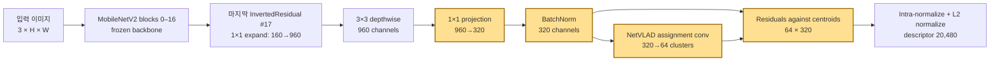
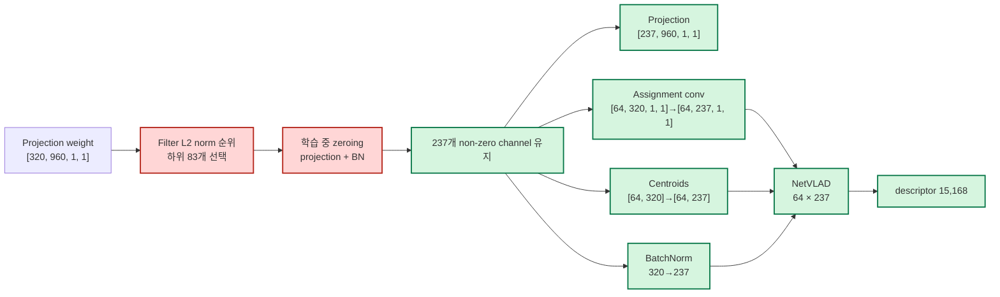

# MobileNetV2 + NetVLAD pruning 구현 및 실험 결과

최종 갱신: 2026-09-05
주요 실행: 2026-08-31 ~ 2026-09-01

이 문서는 현재 저장소의 실제 구현 방법과 Pittsburgh30k 실험 결과를 한곳에
정리한다. 옮겨온 구버전 기록과 현재 코드에서 직접 측정한 결과는 구분해서
표기한다.

## 1. 목표와 최종 결론

프로젝트의 목표 최적화율은 다음 식으로 계산한다.

```text
최적화율(%) = 100 × (기준 모델 B - 최적화 모델 A) / 기준 모델 B
```

기존 실험과 같은 `trainable parameters` 기준에서 B는 ResNet18의 2,132,480개다.
80%를 달성하려면 A가 426,496개 이하여야 한다.

MobileNetV2 마지막 projection 출력 320채널 가운데 83개를 제거한 결과 A는
424,410개가 됐다.

```text
100 × (2,132,480 - 424,410) / 2,132,480 = 80.0978%
```

따라서 **학습 가능 파라미터 기준 목표 80%를 달성**했다. 전체 파라미터를
기준으로 계산하면 37.4118%이므로 보고 시 기준을 반드시 함께 밝혀야 한다.

성능 기준 최종 후보는 두 개다.

| 용도 | Checkpoint | Epoch | Test R@1 | Test R@5 |
|---|---|---:|---:|---:|
| R@1 우선 | `best_r1_reduced.pt` | 4 | **0.6920** | 0.8392 |
| 기존 R@5 선택 기준 | `best_reduced.pt` | 2 | 0.6891 | **0.8417** |

## 2. 전체 아키텍처

### 2.1 Pruning 전



torchvision MobileNetV2의 마지막 `Conv2dNormActivation(320→1280)`과 classifier는
사용하지 않는다. `features[:-1]`까지만 encoder로 사용하므로 마지막 local
descriptor 차원 D는 320이다. `num_clusters=64`인 NetVLAD의 최종 descriptor
크기는 `K × D = 64 × 320 = 20,480`이다.

마지막 InvertedResidual은 입력 160채널, 출력 320채널이라 residual shortcut이
없다. 따라서 출력 channel을 줄여도 앞 블록의 skip connection이나 다른 branch를
함께 수정할 필요가 없다. 현재 구현이 마지막 projection을 pruning 대상으로
선택한 가장 큰 구조적 이유다.

### 2.2 Pruning과 structural reduction 후



NetVLAD 자체를 그대로 두는 것이 아니라, encoder에서 제거된 channel을 소비하는
assignment convolution의 입력 축과 centroid의 descriptor 축을 동일한 index로
함께 줄인다. 다만 cluster 수 K=64는 줄이지 않는다. cluster pruning은 centroid
재학습과 별도의 품질 검증이 필요한 다른 압축 문제다.

## 3. 모델 구성 구현

관련 코드:

- `src/robot_compression/models/factory.py`
- `src/robot_compression/models/netvlad.py`

### 3.1 MobileNetV2 encoder

구버전 torchvision의 `pretrained=True`가 사용하던 가중치는
`IMAGENET1K_V1`이다. 현재 torchvision의 `DEFAULT`는 V2이므로, 재현을 위해
V1을 명시적으로 선택한다.

```text
torchvision MobileNetV2 features
├── blocks 0–16: frozen
├── block 17: trainable
│   ├── 1×1 expansion 160→960
│   ├── 3×3 depthwise 960
│   └── 1×1 projection 960→320 + BatchNorm
└── final 1×1 320→1280: 제외
```

기본 pretrained 설정에서는 `layers[:-1]`을 freeze하고 마지막 InvertedResidual과
NetVLAD만 학습한다. 이 때문에 trainable parameter 기준 압축률은 total parameter
기준보다 훨씬 크게 계산된다.

### 3.2 NetVLAD

encoder feature map의 각 spatial descriptor를 `x_i`, cluster centroid를 `c_k`,
soft assignment를 `a_k(x_i)`라고 하면 cluster별 residual은 다음과 같다.

```text
V_k = Σ_i a_k(x_i) × (x_i - c_k)
```

구현 순서는 다음과 같다.

1. 입력 descriptor를 channel 방향으로 L2 normalize한다.
2. 1×1 convolution과 cluster 방향 softmax로 64개 cluster assignment를 만든다.
3. 각 cluster centroid와의 residual을 assignment로 가중 합산한다.
4. cluster별 intra-normalization을 적용한다.
5. `K × D`로 flatten한 뒤 전체 L2 normalization을 적용한다.

Clustering 모드는 train database image에서 500장을 뽑고 이미지마다 local
descriptor 100개를 표본화해 총 50,000개를 구성한다. Faiss K-means를 100회
iteration으로 실행하고 descriptor와 centroid를 HDF5에 저장한다.

## 4. 학습 구현

관련 코드:

- `src/robot_compression/training/engine.py`
- `src/robot_compression/data/pittsburgh.py`
- `src/robot_compression/cli.py`

### 4.1 Hard-negative mining

각 cache 구간에서 현재 student로 전체 train database/query descriptor를 추출해
HDF5 cache를 만든다. Pittsburgh의 positive radius 조건과 descriptor 거리를
사용해 query마다 positive와 hard negative를 구성한다.

학습 batch는 query, positive, 여러 negative image를 이어 붙여 한 번에 encoder와
NetVLAD를 통과한다. loss는 negative별 TripletMarginLoss의 합을 실제 negative
개수로 나눈 값이다.

```text
TripletMarginLoss(margin=sqrt(0.1), p=2, reduction="sum")
```

### 4.2 Optimizer와 scheduler

| 항목 | 값 |
|---|---:|
| Optimizer | SGD |
| 초기 learning rate | 1e-4 |
| Momentum | 0.9 |
| Weight decay | 1e-3 |
| Scheduler | StepLR(step_size=5, gamma=0.5) |
| Epoch | 30 |
| Batch size | 1 |
| Cache batch size | 48 |
| Workers | 8 |
| Seed | 42 |

### 4.3 KD를 끈 이유

옮겨온 구버전 코드는 student soft-assignment logits까지 `no_grad` 블록에서
계산했다. 따라서 KD loss가 student에 gradient를 전달하지 않았고, 구버전의
“KD 적용 결과”는 실질적으로 triplet 학습 결과로 보는 것이 타당하다.

현재 코드는 student logits를 gradient graph 안에서 계산하도록 수정했지만 다른
문제가 남는다. teacher와 student가 서로 독립적인 K-means로 centroid를 만들면
cluster 번호의 의미가 정렬되지 않는다. 예를 들어 teacher cluster 0과 student
cluster 0이 같은 장소 패턴을 나타낸다는 보장이 없다. 정렬되지 않은 logits에
KL divergence를 적용하는 것은 의미가 보장되지 않는다.

따라서 구버전과 비교하는 15% 및 26% 공식 run은 `--kd-weight 0`으로 수행했다.
향후 KD는 다음 중 하나가 필요하다.

- teacher/student cluster matching 후 logit KD
- 최종 global descriptor를 같은 차원으로 투영한 embedding KD
- retrieval ranking 또는 pairwise-distance KD

## 5. Pruning 구현

관련 코드: `src/robot_compression/compression/mobilenet.py`

### 5.1 Channel 중요도

마지막 projection convolution의 output filter `W_j`마다 L2 norm을 계산한다.

```text
score_j = ||W_j||₂
prune_count = int(number_of_filters × pruning_ratio)
```

26% 설정에서는 다음과 같다.

```text
number_of_filters = 320
prune_count = int(320 × 0.26) = 83
realized_ratio = 83 / 320 = 25.9375%
kept_channels = 320 - 83 = 237
```

norm이 작은 83개 index를 선택해 매 optimizer step 직후 다음 값을 다시 0으로
만든다.

- projection convolution output filter
- projection bias가 존재하는 경우 해당 bias
- BatchNorm weight와 bias
- BatchNorm running mean은 0, running variance는 1

zeroing은 tensor shape를 바꾸지 않는다. 따라서 pruning 학습 checkpoint의
encoder 출력과 NetVLAD 입력은 여전히 320채널이다.

### 5.2 80% 경계 계산

마지막 descriptor channel 한 개를 구조적으로 제거할 때 없어지는 parameter는
1,090개다.

| 대상 | Channel당 제거 수 |
|---|---:|
| Projection weight | 960 |
| BatchNorm weight/bias | 2 |
| NetVLAD assignment conv | 64 |
| NetVLAD centroid | 64 |
| 합계 | **1,090** |

MobileNetV2의 시작 trainable parameter는 514,880개다.

```text
81개 제거: 514,880 - 81 × 1,090 = 426,590  → 목표보다 94개 많음
82개 제거: 514,880 - 82 × 1,090 = 425,500  → 80% 달성
최소 비율: 82 / 320 = 25.625%
83개 제거: 514,880 - 83 × 1,090 = 424,410  → 이번 결과
```

## 6. Structural reduction 구현

`apply_mobilenet_v2_reduction()`은 projection filter norm이 0이 아닌 index를
`kept_indices`로 구한다. 이후 원본 모델을 복제하고 다음 모듈을 새 shape로
교체한다.

| 모듈 | 축소 전 | 축소 후 | 복사 축 |
|---|---|---|---|
| Projection Conv2d | `[320, 960, 1, 1]` | `[237, 960, 1, 1]` | output |
| BatchNorm | `[320]` | `[237]` | feature |
| NetVLAD assignment Conv2d | `[64, 320, 1, 1]` | `[64, 237, 1, 1]` | input |
| NetVLAD centroids | `[64, 320]` | `[64, 237]` | descriptor |

축소 checkpoint에는 `reduction_indices`를 저장한다. 로딩할 때 먼저 동일한
237채널 구조를 만든 뒤 state dict를 적용하므로 전체 모델 pickle에 의존하지
않는다. 축소된 parameter shape와 맞지 않는 optimizer/scheduler 상태는 배포용
checkpoint에서 제외한다.

학습 중 0이 되는 parameter는 다음과 같다.

```text
projection: 83 × 960 = 79,680
BatchNorm affine: 83 × 2 = 166
zero parameters: 79,846
```

구조 축소에서는 NetVLAD의 두 입력 축도 함께 없어지므로 실제 제거 parameter는
다음과 같다.

```text
79,846 + (64 × 83) + (64 × 83) = 90,470
```

## 7. Checkpoint와 재현성

각 epoch 종료 후 validation Recall을 측정하고 다음 checkpoint를 저장한다.

| 파일 | 선택 방식 | 용도 |
|---|---|---|
| `best.pt` | validation R@5 최고 | 기존 프로젝트의 공식 선택 기준 |
| `best_r1.pt` | validation R@1 최고 | R@1 중심 배포 후보 |
| `latest.pt` | 마지막 epoch | 학습 재개와 최종 epoch 확인 |

`latest.pt`에는 optimizer와 scheduler state가 포함되며, 학습 인자와 checkpoint의
architecture, cluster 수, pruning 여부/비율, KD weight가 일치할 때만 재개된다.
run 디렉터리에는 실행 명령, Git commit/dirty 상태, 환경, 데이터 경로, GPU,
seed를 기록한다.

## 8. 평가 구현

관련 코드: `src/robot_compression/training/engine.py`

1. model을 eval mode로 두고 database와 query descriptor를 추출한다.
2. database descriptor를 `faiss.IndexFlatL2`에 추가한다.
3. 각 query의 상위 20개 database 예측을 검색한다.
4. Pittsburgh ground-truth positive 중 하나가 상위 N개 안에 있으면 Recall@N을
   성공으로 계산한다.

평가 데이터 크기는 다음과 같다.

| Split | Database | Query |
|---|---:|---:|
| Train | 10,000 | 7,416 |
| Validation | 10,000 | 7,608 |
| Test | 10,000 | 6,816 |

## 9. 실행 환경

| 항목 | 값 |
|---|---|
| Dataset | Pittsburgh30k train/val/test |
| Pooling | NetVLAD, 64 clusters |
| MobileNetV2 weights | `IMAGENET1K_V1` |
| Centroid | V1 encoder descriptor 50,000개로 새로 생성 |
| Python | 프로젝트 전용 `.venv`, Python 3.10 |
| PyTorch | 2.7.1+cu128 |
| CUDA runtime | 12.8 |
| 실행 GPU | 물리 GPU 0, 논리 `cuda:0` |

26% run은 2026-09-01 10:56부터 20:15까지 실행됐다. 공용 GPU 0에 다른 작업이
들어온 구간이 있어 벽시계 시간은 약 9시간 20분이었다. OOM이나 checkpoint
resume은 발생하지 않았다.

## 10. 실험 결과

### 10.1 ResNet18 기준 모델

현재 코드 재현 run: `20260831_164217_resnet18_netvlad`, epoch 4

| Split | R@1 | R@5 | R@10 | R@20 |
|---|---:|---:|---:|---:|
| Validation | 0.7896 | 0.9114 | 0.9426 | 0.9661 |
| Test | 0.8078 | 0.9024 | 0.9300 | 0.9520 |

### 10.2 ImageNet V2 진단

현재 torchvision `DEFAULT`인 V2로 시작했던 run은 V1 재현 결과보다 현저히
낮아 진단 후 중단했다. 표는 저장된 best checkpoint를 다시 평가한 값이다.

| 실험 | Epoch | Split | R@1 | R@5 | R@10 | R@20 |
|---|---:|---|---:|---:|---:|---:|
| V2 + soft-assignment KD | 2 | Validation | 0.3785 | 0.5860 | 0.6722 | 0.7560 |
| V2 + soft-assignment KD | 2 | Test | 0.4710 | 0.6898 | 0.7748 | 0.8438 |
| V2 + triplet only | 1 | Validation | 0.3822 | 0.5715 | 0.6555 | 0.7384 |
| V2 + triplet only | 1 | Test | 0.4941 | 0.6935 | 0.7669 | 0.8339 |

### 10.3 15% pruning 재현

V1 + triplet-only run의 val R@5 best는 epoch 2다.

| Split | 상태 | R@1 | R@5 | R@10 | R@20 |
|---|---|---:|---:|---:|---:|
| Validation | zero-pruned | 0.7169 | 0.8864 | 0.9298 | 0.9566 |
| Validation | reduced | 0.7137 | 0.8838 | 0.9294 | 0.9572 |
| Test | zero-pruned | 0.7073 | 0.8484 | 0.8928 | 0.9256 |
| Test | reduced | 0.7039 | 0.8474 | 0.8922 | 0.9241 |

15% reduced trainable parameter는 462,560개이고 ResNet18 대비 압축률은
78.3088%다.

### 10.4 26% pruning의 30 epoch validation 곡선

| Epoch | Loss | LR | R@1 | R@5 | R@10 | R@20 |
|---:|---:|---:|---:|---:|---:|---:|
| 1 | 0.2552 | 1e-4 | 0.6600 | 0.8456 | 0.8967 | 0.9381 |
| 2 | 0.2318 | 1e-4 | 0.7115 | **0.8788** | **0.9211** | **0.9482** |
| 3 | 0.2121 | 1e-4 | 0.7099 | 0.8774 | 0.9177 | 0.9469 |
| 4 | 0.1950 | 1e-4 | **0.7191** | 0.8742 | 0.9168 | 0.9457 |
| 5 | 0.1754 | 1e-4 | 0.6906 | 0.8555 | 0.9018 | 0.9363 |
| 6 | 0.1637 | 5e-5 | 0.6939 | 0.8595 | 0.9055 | 0.9384 |
| 7 | 0.1581 | 5e-5 | 0.6940 | 0.8558 | 0.9035 | 0.9341 |
| 8 | 0.1505 | 5e-5 | 0.6869 | 0.8513 | 0.9005 | 0.9345 |
| 9 | 0.1442 | 5e-5 | 0.6749 | 0.8496 | 0.8951 | 0.9310 |
| 10 | 0.1385 | 5e-5 | 0.6941 | 0.8569 | 0.9056 | 0.9391 |
| 11 | 0.1361 | 2.5e-5 | 0.7041 | 0.8661 | 0.9100 | 0.9399 |
| 12 | 0.1346 | 2.5e-5 | 0.6956 | 0.8552 | 0.8992 | 0.9327 |
| 13 | 0.1299 | 2.5e-5 | 0.6845 | 0.8478 | 0.8959 | 0.9353 |
| 14 | 0.1300 | 2.5e-5 | 0.6805 | 0.8441 | 0.8951 | 0.9299 |
| 15 | 0.1259 | 2.5e-5 | 0.6814 | 0.8495 | 0.8943 | 0.9309 |
| 16 | 0.1239 | 1.25e-5 | 0.6719 | 0.8442 | 0.8948 | 0.9295 |
| 17 | 0.1247 | 1.25e-5 | 0.6801 | 0.8499 | 0.9002 | 0.9365 |
| 18 | 0.1220 | 1.25e-5 | 0.6769 | 0.8488 | 0.8988 | 0.9336 |
| 19 | 0.1237 | 1.25e-5 | 0.6798 | 0.8498 | 0.9014 | 0.9356 |
| 20 | 0.1207 | 1.25e-5 | 0.6807 | 0.8511 | 0.9025 | 0.9366 |
| 21 | 0.1205 | 6.25e-6 | 0.6795 | 0.8506 | 0.9000 | 0.9343 |
| 22 | 0.1182 | 6.25e-6 | 0.6877 | 0.8594 | 0.9059 | 0.9397 |
| 23 | 0.1212 | 6.25e-6 | 0.6853 | 0.8555 | 0.9025 | 0.9364 |
| 24 | 0.1197 | 6.25e-6 | 0.6890 | 0.8546 | 0.9027 | 0.9394 |
| 25 | 0.1185 | 6.25e-6 | 0.6743 | 0.8442 | 0.8958 | 0.9340 |
| 26 | 0.1175 | 3.125e-6 | 0.6857 | 0.8540 | 0.9047 | 0.9405 |
| 27 | 0.1166 | 3.125e-6 | 0.6847 | 0.8558 | 0.9094 | 0.9384 |
| 28 | 0.1186 | 3.125e-6 | 0.6839 | 0.8515 | 0.8984 | 0.9366 |
| 29 | 0.1187 | 3.125e-6 | 0.6744 | 0.8488 | 0.8988 | 0.9361 |
| 30 | 0.1192 | 3.125e-6 | 0.6760 | 0.8478 | 0.8992 | 0.9353 |

R@5/R@10/R@20 최고는 epoch 2, R@1 최고는 epoch 4다. loss 최저는 epoch
27이지만 validation Recall은 초기 최고점보다 낮다. 따라서 마지막 epoch가 아닌
validation-selected checkpoint를 배포해야 한다.

### 10.5 26% structural reduction 전후

| Checkpoint | Split | 상태 | R@1 | R@5 | R@10 | R@20 |
|---|---|---|---:|---:|---:|---:|
| R@5 best, epoch 2 | Validation | zero-pruned | 0.7115 | 0.8788 | 0.9211 | 0.9482 |
| R@5 best, epoch 2 | Validation | reduced | 0.7031 | 0.8755 | 0.9194 | 0.9461 |
| R@5 best, epoch 2 | Test | zero-pruned | 0.6931 | 0.8461 | 0.8906 | 0.9244 |
| R@5 best, epoch 2 | Test | reduced | 0.6891 | 0.8417 | 0.8879 | 0.9222 |
| R@1 best, epoch 4 | Validation | zero-pruned | 0.7191 | 0.8742 | 0.9168 | 0.9457 |
| R@1 best, epoch 4 | Validation | reduced | 0.7131 | 0.8700 | 0.9139 | 0.9435 |
| R@1 best, epoch 4 | Test | zero-pruned | 0.6979 | 0.8445 | 0.8928 | 0.9274 |
| R@1 best, epoch 4 | Test | reduced | 0.6920 | 0.8392 | 0.8906 | 0.9250 |
| Last, epoch 30 | Test | zero-pruned | 0.6463 | 0.8235 | 0.8722 | 0.9102 |
| Last, epoch 30 | Test | reduced | 0.6401 | 0.8201 | 0.8693 | 0.9089 |

test에서 structural reduction 자체가 만든 변화는 다음과 같다.

| Checkpoint | ΔR@1 | ΔR@5 | ΔR@10 | ΔR@20 |
|---|---:|---:|---:|---:|
| Epoch 2 | -0.40%p | -0.44%p | -0.26%p | -0.22%p |
| Epoch 4 | -0.59%p | -0.53%p | -0.22%p | -0.23%p |
| Epoch 30 | -0.62%p | -0.34%p | -0.29%p | -0.13%p |

### 10.6 파라미터와 파일 크기

| 모델 | Encoder ch | Descriptor | Total | Trainable | Zero |
|---|---:|---:|---:|---:|---:|
| ResNet18 기준 | 256 | 16,384 | 2,815,552 | 2,132,480 | 0 |
| MobileNetV2 zero-pruned | 320 | 20,480 | 1,852,672 | 514,880 | 79,846 |
| MobileNetV2 15% reduced | 272 | 17,408 | 1,800,352 | 462,560 | 0 |
| MobileNetV2 26% reduced | 237 | 15,168 | 1,762,202 | 424,410 | 0 |

| 비교 | Total 감소율 | Trainable 감소율 |
|---|---:|---:|
| 26% reduced vs ResNet18 | 37.4118% | **80.0978%** |
| 26% reduced vs MobileNetV2 | 4.8832% | 17.5711% |

| 파일 | Bytes | 학습 checkpoint 대비 감소 |
|---|---:|---:|
| `best.pt` | 9,688,882 | - |
| `best_reduced.pt` | 7,282,617 | 24.84% |
| `best_r1.pt` | 9,705,985 | - |
| `best_r1_reduced.pt` | 7,283,559 | 24.96% |
| `latest.pt` | 9,701,308 | - |
| `latest_reduced.pt` | 7,283,245 | 24.93% |

파일 감소에는 구조 축소와 optimizer/scheduler 제거가 모두 포함되므로 공식
파라미터 압축률로 사용하지 않는다.

### 10.7 구버전 기록과의 차이

옮겨온 구버전 reduced test 결과는 R@1 0.7199, R@5 0.8662였다. 현재 26%
reduced 모델은 압축률 목표는 달성했지만 test R@1이 2.79~3.08%p 낮아 구버전의
절대 Recall까지 완전히 재현한 것은 아니다.

## 11. 재현 명령

```bash
./scripts/bootstrap_env.sh
source .venv/bin/activate
./scripts/check_resources.sh

robot-compression check
robot-compression cluster --arch mobilenetv2 --num-clusters 64

CUDA_VISIBLE_DEVICES=0 robot-compression train \
  --arch mobilenetv2 \
  --num-clusters 64 \
  --epochs 30 \
  --batch-size 1 \
  --cache-batch-size 48 \
  --workers 8 \
  --kd-weight 0 \
  --pruning \
  --pruning-ratio 0.26
```

구조 축소와 test 평가는 다음과 같다.

```bash
CUDA_VISIBLE_DEVICES=0 robot-compression reduce \
  --checkpoint artifacts/runs/<run>/checkpoints/best_r1.pt \
  --output artifacts/runs/<run>/checkpoints/best_r1_reduced.pt \
  --pruning-ratio 0.26

CUDA_VISIBLE_DEVICES=0 robot-compression test \
  --checkpoint artifacts/runs/<run>/checkpoints/best_r1_reduced.pt \
  --split test \
  --cache-batch-size 48 \
  --workers 8
```

## 12. 산출물과 검증

26% run 로컬 경로:

```text
artifacts/runs/20260901_105613_mobilenetv2_netvlad_prune0p26/
├── run_metadata.json
├── metrics.csv
├── evaluation.json
└── checkpoints/
    ├── best.pt
    ├── best_reduced.pt
    ├── best_r1.pt
    ├── best_r1_reduced.pt
    ├── latest.pt
    └── latest_reduced.pt
```

검증 완료 항목:

- 30개 epoch 지표 저장 확인
- R@1/R@5 best checkpoint epoch 확인
- reduced checkpoint 재로딩 확인
- 237채널 forward 출력 `(1, 15168)` 확인
- 축소 전후 val/test 전체 재평가
- pytest 5개 통과
- CPU pruning/reduction/KD gradient smoke test 통과

## 13. 한계와 다음 단계

- 80%는 trainable parameter 기준이며 total parameter 기준은 아니다.
- seed 42 한 번의 30 epoch 결과이므로 여러 seed의 평균과 분산이 필요하다.
- 현재는 마지막 descriptor channel만 pruning한다. total parameter 압축을 크게
  높이려면 중간 inverted residual channel까지 dependency-aware하게 줄여야 한다.
- NetVLAD cluster 수는 64로 유지했다. cluster pruning은 centroid 재생성과
  Recall 검증이 필요하다.
- 실제 로봇 배포 판단에는 ONNX/TensorRT 변환 후 latency, peak memory, 전력
  측정이 추가로 필요하다.
